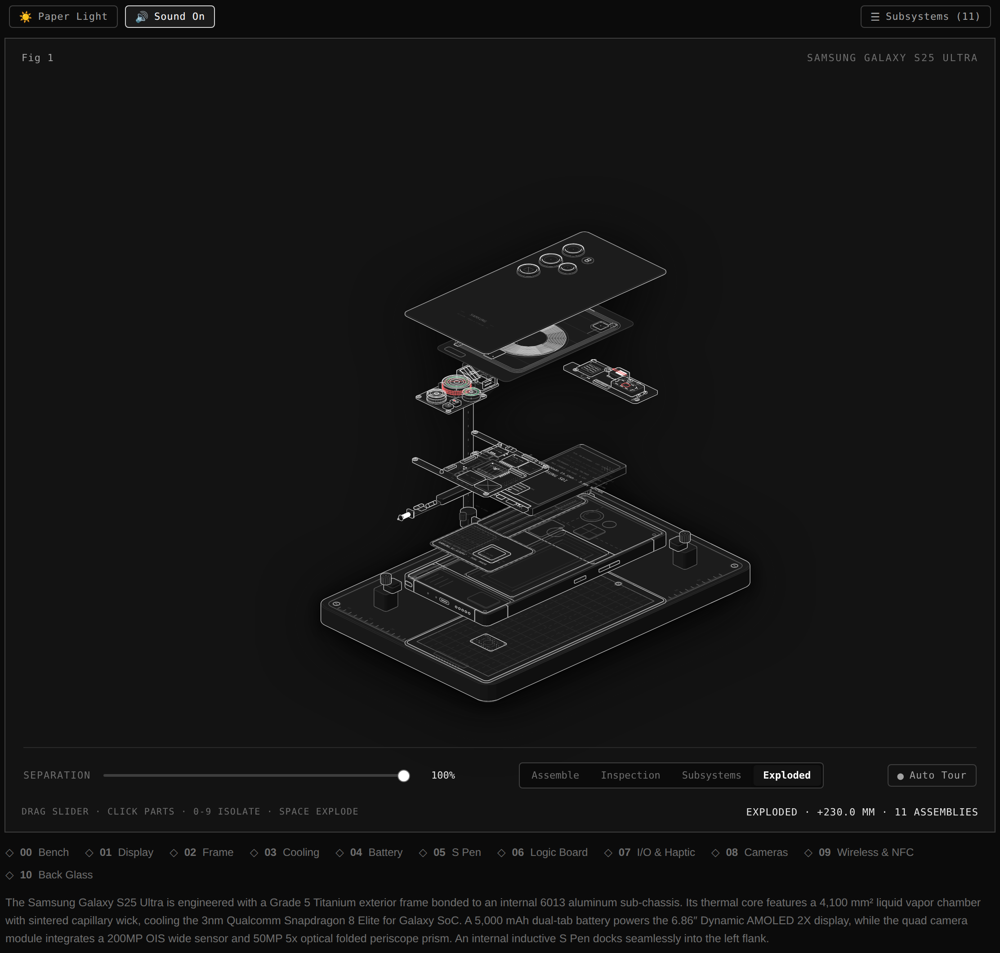

# Samsung Galaxy S25 Ultra · Anatomy & Teardown

An interactive, surgical procedural isometric teardown and engineering inspection of the **Samsung Galaxy S25 Ultra**. Built with 100% pure procedural SVG, dynamic camera optics, procedural Web Audio API synthesis, and zero external framework bloat.



---

## ⚡ Highlights & Engineering Architecture

- **Procedural Isometric Drafting**: True mathematical isometric projection (Azimuth 44°, Elevation 28°) rendered with a zero-floating-line tolerance policy.
- **11 Surgical Subsystems**:
  - `[00]` Precision Titanium Assembly Fixture
  - `[01]` 6.9″ Dynamic AMOLED 2X Display (Corning Gorilla Armor)
  - `[02]` Grade 5 Titanium Armor Frame (Ti-6Al-4V)
  - `[03]` 4,100 mm² Liquid Vapor Chamber with sintered capillary wick
  - `[04]` 5,000 mAh High-Density Dual-Tab Pouch Cell
  - `[05]` Wacom 0.3mm Active EMR Digitizer & S Pen Silo
  - `[06]` Qualcomm Snapdragon 8 Elite Motherboard (3nm N3E)
  - `[07]` High-Speed USB-C 3.2 Gen 2 Sub-Board & Haptic LRA
  - `[08]` Quad ISOCELL Camera Cluster with Folded 5× Periscope
  - `[09]` Qi2 Fast Wireless Charging Coil & NFC Antenna
  - `[10]` Gorilla Glass Victus 2 Satin Back Glass
- **Dual-Axis Voice Coil Motor (VCM) Gyro**: Real-time cursor and touch tracking simulating physical optical image stabilization on the 200MP lens and periscope prism.
- **Procedural Web Audio Engine**: Zero-asset procedural synthesis for mechanical separation ratchets, shutter curtains, S Pen spring pop, and capillary thermal hum.
- **Kinetic Engineering Triggers**:
  - 📷 **Snap Shutter**: Dual-curtain mechanical shutter simulation with exposure metadata.
  - ⚡ **Benchmark Stress**: 4.47 GHz thermal stress test with real-time temperature ramp and animated capillary wick fluid flow.
  - ⏏ **Eject S Pen**: Microswitch spring extraction with telemetry feedback.
- **100% Responsive Ergonomics**: Optimized for all devices from 360px compact mobile screens to 4K displays, with bottom-docked collapsible telemetry sheets and 44px touch compliance.

---

## 🚀 Live Demo & Deployment

The application is deployed on Vercel as a pure static web application.

- Primary entrypoint: `index.html` (self-contained dark/light theme switchable)
- Dark mode direct: `galaxy-s25-ultra.html`
- Light mode direct: `galaxy-s25-ultra-light.html`

---

## 🛠️ Verification & Quality Assurance

Run the automated regression verification and line audit suite:

```bash
node modules/verification.mjs
```

This verifies:
- Web Audio synthesis integrity
- Cinematic camera presets
- Interactive SVG component hook IDs
- Zero-floating-line audit (1,698 endpoints across 607 lines)

---

## 📄 License

MIT
